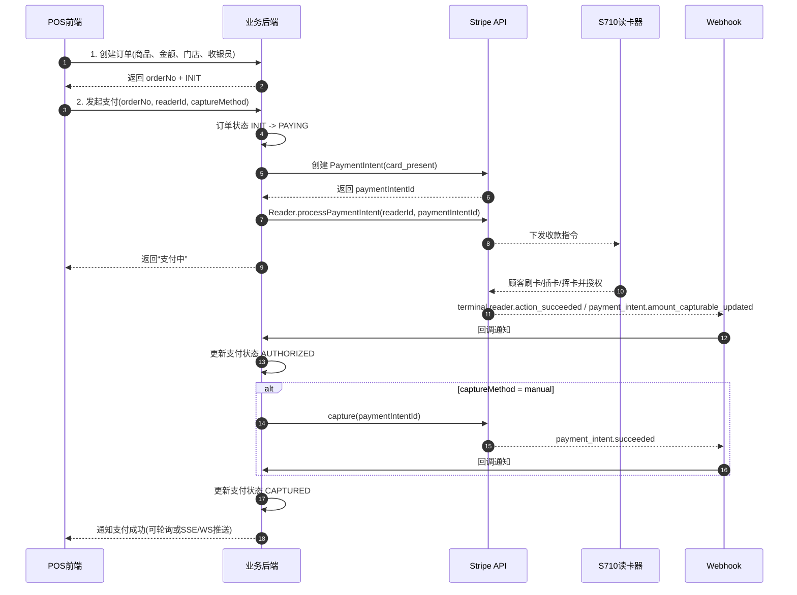
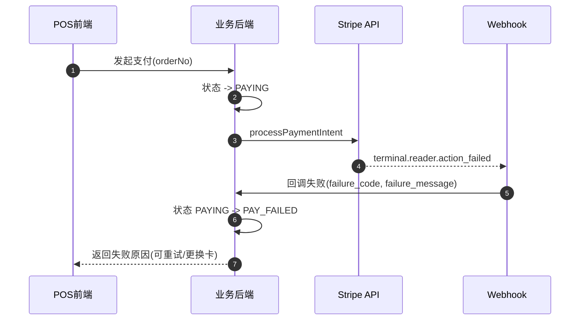
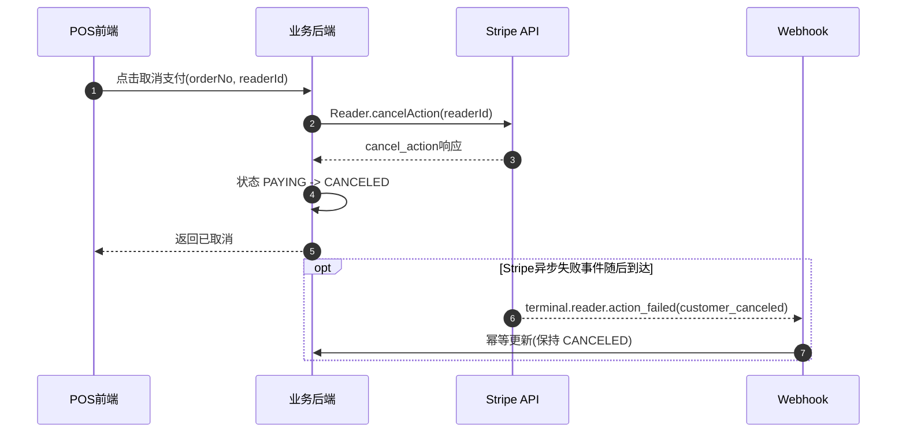
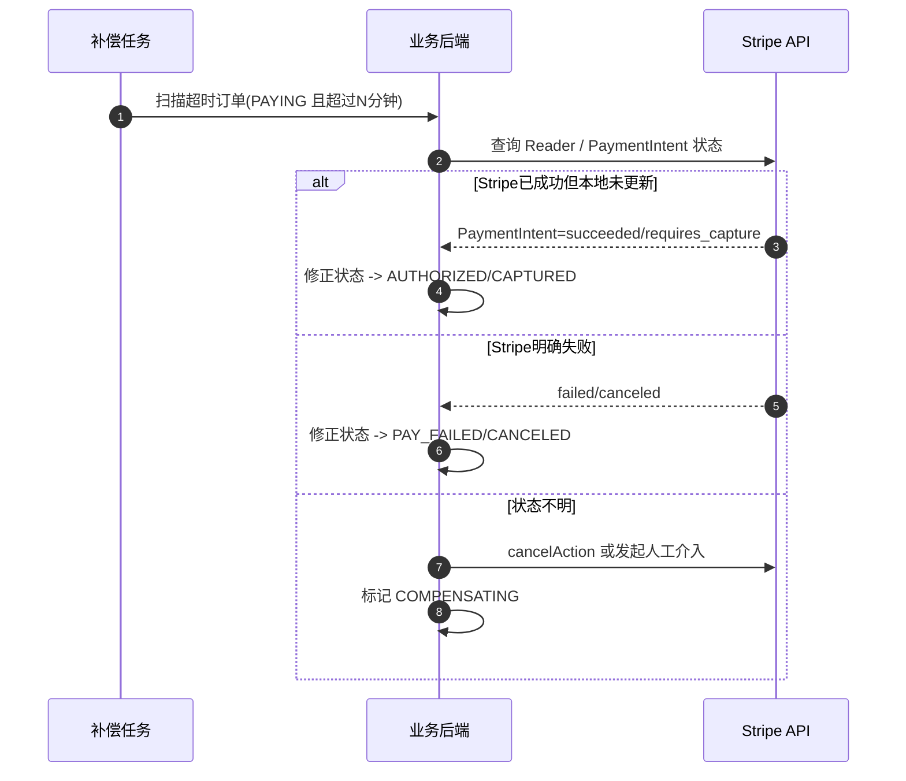

# Stripe Terminal 业务落地时序与状态机设计

## 1. 目标

面向业务系统落地 Stripe Terminal（S710）支付，定义：

- 下单到收款完成的主链路
- 支付失败、撤销、补偿的处理链路
- 可直接落库的订单状态机字段

## 2. 角色与系统边界

- `POS前端`：收银员操作界面
- `业务后端`：订单系统（你们系统）
- `Stripe API`：支付服务
- `S710`：读卡器设备
- `Webhook`：Stripe 异步回调到业务后端

## 3. 主流程时序图（下单 -> 支付中 -> 成功）

## 4. 失败流程时序图（支付失败）

## 5. 撤销流程时序图（主动取消）

## 6. 补偿流程时序图（超时/状态不一致）

## 7. 订单状态机（建议）

### 7.1 订单主状态 `order_status`

- `INIT`：已下单，未发起支付
- `PAYING`：已下发到读卡器，等待顾客操作
- `AUTHORIZED`：已授权（manual capture 场景）
- `CAPTURED`：支付完成（最终成功）
- `PAY_FAILED`：支付失败
- `CANCELED`：用户/收银员取消
- `COMPENSATING`：补偿处理中
- `CLOSED`：订单完结（可选，业务归档态）

### 7.2 支付子状态 `payment_status`

- `NOT_STARTED`
- `REQUIRES_PAYMENT_METHOD`
- `IN_PROGRESS`
- `REQUIRES_CAPTURE`
- `SUCCEEDED`
- `FAILED`
- `CANCELED`

## 8. 数据库字段设计（建议）

## `t_pos_order`

- `id` bigint PK
- `order_no` varchar(64) 唯一订单号
- `location_id` varchar(64) Stripe Location ID (`tml_xxx`)
- `reader_id` varchar(64) Stripe Reader ID
- `amount` bigint 订单金额（分）
- `currency` varchar(16)
- `capture_method` varchar(16) manual/automatic
- `order_status` varchar(32)
- `payment_status` varchar(32)
- `payment_intent_id` varchar(64)
- `client_reference_id` varchar(64)
- `fail_code` varchar(64)
- `fail_message` varchar(512)
- `version` int 乐观锁版本
- `created_time` datetime
- `updated_time` datetime

索引建议：

- `uk_order_no(order_no)`
- `idx_payment_intent_id(payment_intent_id)`
- `idx_order_status_updated(order_status, updated_time)`

## `t_pos_order_event`（事件流水）

- `id` bigint PK
- `order_no` varchar(64)
- `event_type` varchar(64)（CREATE_ORDER / START_PAY / WEBHOOK_xxx / CAPTURE / CANCEL / COMPENSATE）
- `event_source` varchar(32)（POS / WEBHOOK / JOB / MANUAL）
- `stripe_event_id` varchar(64)（Webhook去重关键）
- `payload` text/json
- `created_time` datetime

索引建议：

- `uk_stripe_event_id(stripe_event_id)`（允许空，非Webhook可空）
- `idx_order_no(order_no)`

## 9. 状态流转规则（强约束）

- `INIT -> PAYING`
- `PAYING -> AUTHORIZED | PAY_FAILED | CANCELED`
- `AUTHORIZED -> CAPTURED | CANCELED | COMPENSATING`
- `PAY_FAILED -> PAYING`（允许重试同一订单）
- `COMPENSATING -> AUTHORIZED | CAPTURED | PAY_FAILED | CANCELED`

禁止跳转：

- `CAPTURED` 不可再回退到 `PAYING`
- `CANCELED` 不可直接到 `CAPTURED`

## 10. 幂等与一致性要求

- 下单幂等：`order_no` 唯一
- 支付发起幂等：同一 `order_no` 在 `PAYING` 状态禁止重复下发
- Webhook幂等：`stripe_event_id` 全局去重
- Capture幂等：同一 `payment_intent_id` 多次 capture 仅允许一次成功

## 11. 超时与补偿策略（建议值）

- `PAYING` 超过 `120s` 未收到成功/失败 -> 进入补偿扫描
- `AUTHORIZED` 超过 `30min` 未 capture -> 告警
- `AUTHORIZED` 超过 `24h` 未 capture -> 自动关闭并人工复核（可按业务调整）

## 12. 接口映射到状态机

- `POST /api/terminal/payments`：`INIT -> PAYING`
- Webhook `terminal.reader.action_succeeded`：`PAYING -> AUTHORIZED`（manual）或 `CAPTURED`（automatic）
- Webhook `terminal.reader.action_failed`：`PAYING -> PAY_FAILED`
- `POST /api/terminal/payments/capture`：`AUTHORIZED -> CAPTURED`
- `POST /api/terminal/readers/cancel-action`：`PAYING -> CANCELED`
- 补偿任务：`PAYING/AUTHORIZED -> COMPENSATING -> 终态`

## 13. 实施优先级

P0：

- 订单主表 + 事件表
- 主状态流转校验
- Webhook验签 + 幂等

P1：

- 补偿任务（超时扫描、状态修复）
- 告警与监控（PAYING超时、AUTHORIZED未capture）

P2：

- 收银台实时推送（WS/SSE）
- 风控规则与失败码分类运营看板

