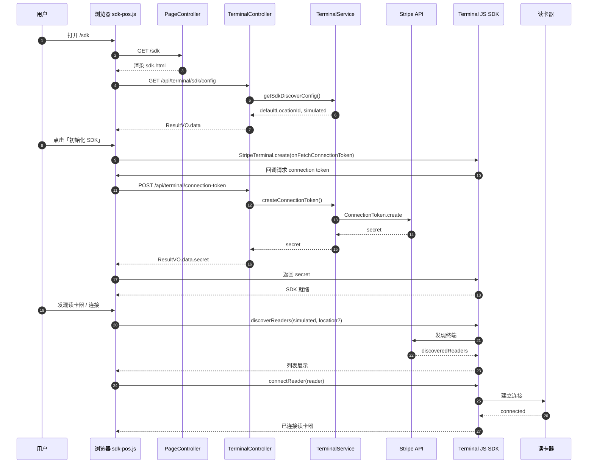
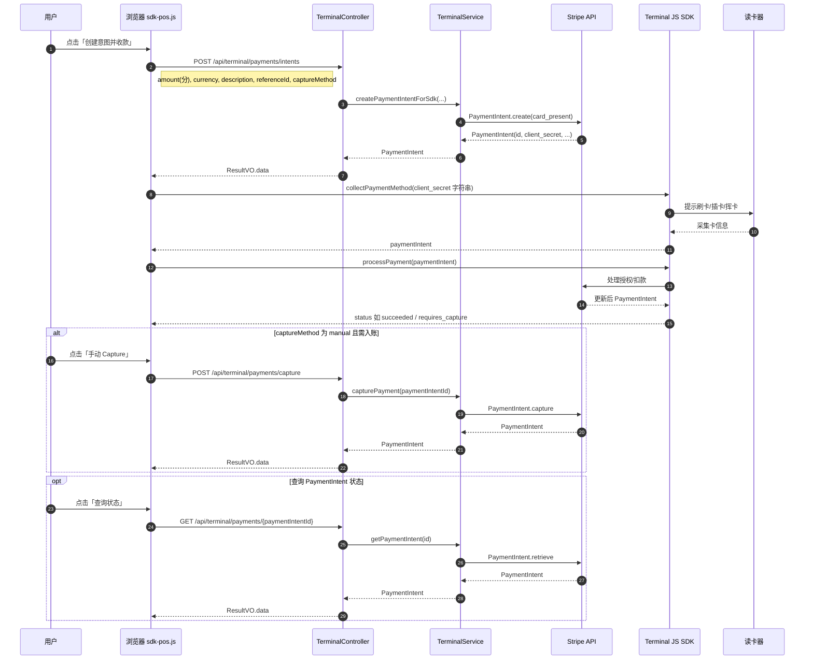

# Stripe Terminal SDK 页面：支付时序图（Mermaid）

本文档描述 `GET /sdk` 示例页（`sdk.html` + `sdk-pos.js`）与后端 `/api/terminal`、Stripe 云端、Terminal JS SDK、读卡器之间的交互顺序。

---

## 1. 页面加载与 SDK 初始化（含 connection-token）

---

## 2. 收款主流程（创建 PI → collect → process → 可选 capture / 查询）

---

## 3. 说明

- **实线 HTTP**：仅上述路径会到达本 Spring 应用；`discoverReaders` / `collectPaymentMethod` / `processPayment` 与 Stripe 的交互由 **Terminal JS SDK** 在浏览器侧发起，不经过 `/api/terminal` 除已列接口外的其它路径。
- **与 Server-Driven 区别**：SDK 页不使用 `POST /api/terminal/payments`（后端直接 `processPaymentIntent` 到读卡器），而是先创建 PI 再由前端 SDK 驱动收款。
